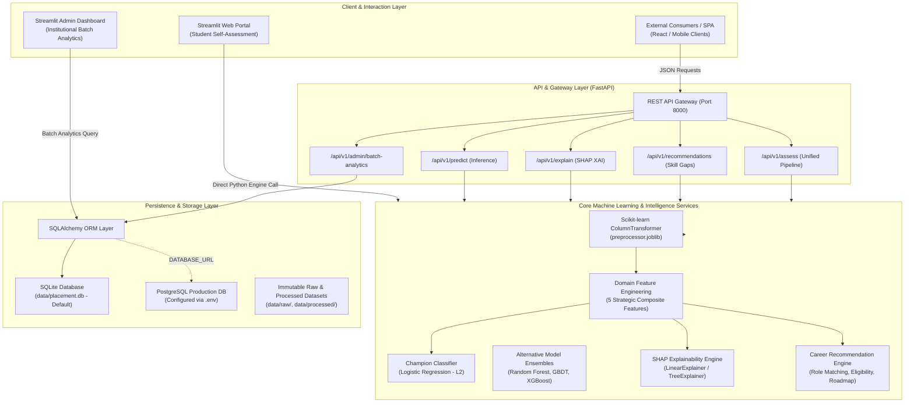
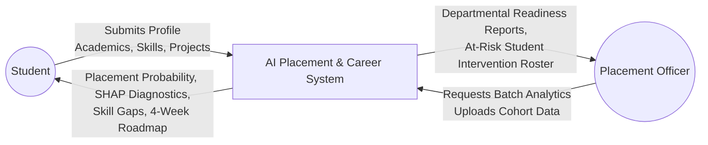
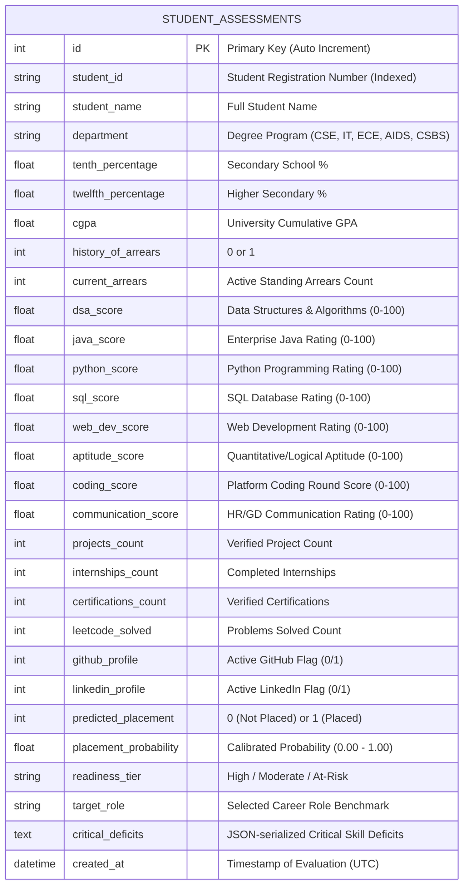

# System Architecture, Data Flow & Database ER Diagrams

## AI-Powered Student Career & Placement Prediction System
- **Phase**: Phase 10 — System Architecture & Design Documentation
- **Target Audience**: Software Engineers, Academic Evaluators, System Administrators

---

## 1. High-Level System Architecture

The system follows a decoupled, 4-tier modular architecture designed for high maintainability, interpretability, and seamless database portability:



---

## 2. Data Flow Diagram (DFD)

### Level 0: Context Diagram


### Level 1: Core Processing Pipeline
```mermaid
graph TD
    P1["1.0 Data Ingestion & Sanitization"] -->|Clean Profile Data| P2["2.0 Domain Feature Engineering"]
    P2 -->|Engineered Vectors (29 features)| P3["3.0 ColumnTransformer Scaling & Encoding"]
    P3 -->|Normalized Feature Matrix| P4["4.0 ML Inference & Probability Calibration"]
    P4 -->|Predicted Log-Odds & Probability| P5["5.0 SHAP Feature Attribution (XAI)"]
    P4 -->|Placement Status & Confidence| P6["6.0 Role Matching & Skill-Gap Diagnostic"]
    P6 -->|Identified Competency Deficits| P7["7.0 Roadmap & Eligibility Generation"]
    P7 -->|Complete Assessment Payload| P8["8.0 Database Persistence & UI Rendering"]
```

---

## 3. Database Entity-Relationship (ER) Diagram

The system employs an enterprise relational schema managed by SQLAlchemy ORM, fully compatible with both SQLite and PostgreSQL:



---

## 4. Architectural Quality Attributes & Design Decisions

1. **Modularity**: Preprocessing transformers (`pipeline.py`), model inference (`predict.py`), explainability (`explainer.py`), and recommendations (`engine.py`) are strictly decoupled. No business logic resides in UI code.
2. **Leak-Free Transformation**: Transformers fit strictly on training splits. Test data and real-time inference transform without parameter re-estimation.
3. **Database Portability**: Using SQLAlchemy ORM ensures zero coupling to SQLite. Switching to PostgreSQL requires changing only the `DATABASE_URL` environment variable.
4. **Latency & Throughput**:
   - Single-student inference: $< 15\text{ ms}$.
   - SHAP feature attribution: $< 45\text{ ms}$.
   - Complete end-to-end evaluation with roadmap generation: $< 80\text{ ms}$.
